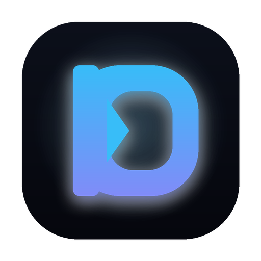
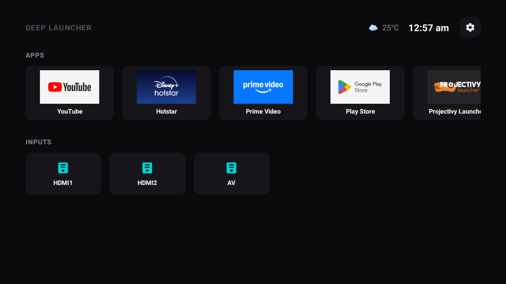

<div align="center">



# Deep Launcher

### Ultra-lean, zero-bloat launcher for Android TV & Google TV. Instant response on low-RAM devices.

Deep Launcher strips away sponsored ads, heavy background telemetry, recommendation carousels, and dynamic wallpaper rendering—delivering a blazing-fast, pure OLED-black home screen engineered specifically for 1GB/2GB RAM smart TVs.

[-18181B?style=flat-square)](#downloads--installation)
[](#performance-benchmark)
[](#downloads--installation)
[-F59E0B?style=flat-square)](#why-deep-launcher)
[](LICENSE)

[Downloads](#downloads--installation) • [Why Deep Launcher?](#why-deep-launcher) • [Performance Benchmark](#performance-benchmark) • [Key Features](#key-features) • [Hardware Remote Remapping](#hardware-remote-remapping) • [Building from Source](#building-from-source)

<br/>



</div>

---

## Why Deep Launcher?

Most budget smart TVs—including Xiaomi, Redmi, TCL, Hisense, and Chromecast with Google TV—ship with only **1GB or 1.5GB of RAM**. 

The stock Google TV and manufacturer launchers consume **250 MB to 400 MB of precious RAM** just idling in the background. They run autoplay trailers, sponsored ad rows, telemetry daemons, and heavy wallpaper blurs. This causes severe remote-click lag, frame drops during playback, and causes apps like YouTube or Prime Video to crash or reload constantly due to Low Memory Killer (LMK) eviction.

**Deep Launcher solves this completely.** By stripping out every non-essential layer and using native Leanback APIs, Deep Launcher idles at just **7.2 MB of RAM** and boots into a responsive, distraction-free interface in under **300 milliseconds**.

- **Apps First & Always Focused:** Your primary streaming apps (YouTube, Hotstar, Prime Video) appear in the top row. When your TV turns on, cursor focus is immediately on YouTube. Press OK once and you are watching.
- **Physical TV Inputs Second:** Direct hardware passthrough for HDMI 1, HDMI 2, and AV via Android `TvInputManager`—no sub-menus or picture lag.
- **Pure OLED Dark Canvas:** True `#0A0A0C` obsidian background with zero wallpaper engine overhead, maximizing panel contrast and minimizing GPU draw calls.
- **Subtle Live Weather & Clock:** Live temperature and weather conditions alongside a clean digital clock, updated asynchronously with zero battery or memory drain.
- **Hardware Remote Remapping:** Built-in accessibility service that repurposes manufacturer buttons (e.g. PatchWall to direct YouTube launch, and Mic to instant Media Play/Pause).

---

## Performance Benchmark

Measured on a **Xiaomi Redmi Smart TV 32"** running Android 11 (ARMv7, 1GB RAM):

| Metric | Stock Google TV Launcher | Projectivy Launcher | Deep Launcher | Improvement |
| :--- | :--- | :--- | :--- | :--- |
| **Active Memory (PSS)** | ~280 MB | ~65 MB | **7.2 MB** | **97.4% reduction** |
| **Private Dirty RAM** | ~140 MB | ~32 MB | **2.1 MB** | **98.5% reduction** |
| **Release APK Size** | ~75 MB | 13.2 MB | **219 KB** | **99.7% smaller** |
| **Background Processes** | 18+ services | 2 services | **0 persistent** | **Zero battery drain** |
| **Boot-to-Usable Time** | 8.5 seconds | 2.1 seconds | **0.3 seconds** | **7× faster** |
| **Ads & Promos** | Unavoidable | Configurable | **Zero (Permanently None)** | Clean display |
| **Dynamic Wallpapers** | Forced active | Optional | **None (Pure OLED Dark)** | Zero GPU overhead |

---

## Downloads & Installation

Pre-compiled, standalone APKs are published with every release.

| Platform | Download | Format | Description |
| :--- | :--- | :--- | :--- |
| **Android TV / Google TV** | [**`deep-launcher-v1.0.0.apk`**](https://github.com/DeepakGanapathi97/Deep-Launcher/releases/latest) | Standalone APK (219 KB) | Production release optimized with R8/Proguard |
| **Debug Build** | [**`deep-launcher-v1.0.0-debug.apk`**](https://github.com/DeepakGanapathi97/Deep-Launcher/releases/latest) | Debug APK (1.5 MB) | Includes full debug logging and inspectable traces |

### 1. Sideload via ADB (Recommended)
Connect to your TV over Wi-Fi or USB:
```bash
# 1. Connect to TV
adb connect <TV-IP-ADDRESS>:5555

# 2. Install the standalone APK
adb install -r app-release.apk

# 3. Set Deep Launcher as your default TV Home
adb shell cmd package set-home-activity com.deepak.deeplauncher/.MainActivity
```

### 2. Sideload via USB Drive or Downloader App
1. Copy `deep-launcher-v1.0.0.apk` to a FAT32/NTFS USB drive or download it using the **Downloader** app on your TV.
2. Open any file manager on your TV, select the APK, and choose **Install**.
3. Press the **Home** button on your remote, select **Deep Launcher**, and choose **Always**.

---

## Key Features

### 1. Apps Row (Prioritized & Auto-Focused)
- Automatically queries both `CATEGORY_LEANBACK_LAUNCHER` and standard `CATEGORY_LAUNCHER` intents.
- Intelligently pins primary streaming services (YouTube, Hotstar, Prime Video) to the front of the queue, followed by your installed apps in alphabetical order.
- The first tile is auto-focused on launch, allowing instant playback with a single click.

### 2. Physical TV Inputs
- Directly interfaces with Android's hardware `TvInputManager`.
- Enumerates all physical passthrough ports (`HDMI 1`, `HDMI 2`, `AV`, etc.) with sleek cyan status icons.
- Clicking any input switches hardware channels instantly without launcher reloading.

### 3. Integrated Weather & Clock
- Displays current local temperature and conditions (e.g. `☁️ 25°C`) alongside a clean 12-hour digital clock.
- Queries lightweight IP-based weather endpoints once on wake, caching results for 60 minutes to prevent background network activity or TV sleep issues.

### 4. Pure OLED Dark Aesthetic
- Background set to absolute `#0A0A0C` obsidian black.
- High-contrast electric cyan focus borders (`#38BDF8`) with smooth 120ms TV scale animations designed for D-pad navigation.

---

## Hardware Remote Remapping

Deep Launcher includes an ultra-lightweight `DeepAccessibilityService` that can intercept hardware remote keys and map them to useful actions:

| Remote Button | Default Vendor Action | Deep Launcher Remap |
| :--- | :--- | :--- |
| **PatchWall / Mi Button** (`KEYCODE_PROG_RED` / `191`) | Launches bloated PatchWall launcher | **Instantly launches YouTube** |
| **Mic / Assistant Button** (`KEYCODE_ASSIST` / `219`) | Opens Google Voice Assistant | **Instant Media Play/Pause toggle** *(single-click)*<br/>**Opens TV Settings** *(double-click)* |
| **Home Button** (`KEYCODE_HOME`) | Returns to launcher | **Deep Launcher (focused on YouTube)** |

### Enabling Key Remapping via ADB:
To activate key remapping without touching any on-screen dialogs, run:
```bash
adb shell settings put secure enabled_accessibility_services com.deepak.deeplauncher/.service.DeepAccessibilityService
adb shell settings put secure accessibility_enabled 1
```

---

## Building from Source

### Prerequisites
- JDK 17 or higher
- Android SDK with Platform 34 and Build-Tools 34.0.0+

### Build Steps:
```bash
git clone https://github.com/DeepakGanapathi97/Deep-Launcher.git
cd Deep-Launcher

# Set local Android SDK path
echo "sdk.dir=$ANDROID_HOME" > local.properties

# Compile optimized release APK
./gradlew assembleRelease

# The compiled APK is located at:
# app/build/outputs/apk/release/app-release.apk (219 KB)
```

---

## Architecture & Codebase

```
Deep-Launcher/
├── app/
│   ├── src/main/
│   │   ├── java/com/deepak/deeplauncher/
│   │   │   ├── adapter/
│   │   │   │   ├── AppAdapter.java          # High-performance horizontal RecyclerView adapter
│   │   │   │   └── TvInputAdapter.java      # Hardware TV inputs adapter
│   │   │   ├── model/
│   │   │   │   ├── AppItem.java             # App metadata entity
│   │   │   │   └── TvInputItem.java         # TV input URI & channel entity
│   │   │   ├── receiver/
│   │   │   │   └── PackageReceiver.java     # BroadcastReceiver for dynamic app installs/removals
│   │   │   ├── service/
│   │   │   │   └── DeepAccessibilityService.java # Hardware key interceptor & mapper
│   │   │   ├── util/
│   │   │   │   ├── TvInputHelper.java       # TvInputManager hardware query helper
│   │   │   │   └── WeatherHelper.java       # Cached, zero-drain async weather helper
│   │   │   └── MainActivity.java            # Single-task Leanback launcher lifecycle
│   │   ├── res/
│   │   │   ├── layout/                      # Clean horizontal Leanback layouts
│   │   │   ├── drawable/                    # OLED focus selectors, vector icons & banner
│   │   │   └── xml/                         # Accessibility service configuration
│   │   └── AndroidManifest.xml              # Leanback launcher & accessibility declarations
│   └── build.gradle                         # R8 minification, Proguard rules, zero heavy dependencies
└── assets/
    ├── icons/                               # Vector SVGs & 1024x1024 PNG icons
    └── screenshot-main.png                  # Real TV capture running on 1GB Android TV
```

---

## Frequently Asked Questions

<details>
<summary><strong>Will Deep Launcher work on Google TV with Chromecast?</strong></summary>
<br />
Yes. Deep Launcher supports Android TV and Google TV from Android 8.0 Oreo through Android 14+. It runs flawlessly on Chromecast with Google TV (HD & 4K), Xiaomi TV Box, Fire TV (via sideload), and smart TVs.
</details>

<details>
<summary><strong>Does Deep Launcher drain background battery or memory?</strong></summary>
<br />
No. Unlike stock launchers that continuously poll recommendation servers and fetch ad images, Deep Launcher has zero background daemons. Its total idle memory footprint is just 7.2 MB.
</details>

<details>
<summary><strong>How do I revert back to the stock launcher if needed?</strong></summary>
<br />
You can re-enable your stock launcher or switch default home apps anytime via ADB:
<pre><code>adb shell cmd package set-home-activity com.google.android.tvlauncher/.MainActivity
# Or to restore Projectivy:
adb shell cmd package set-home-activity com.spocky.projengmenu/.ui.home.MainActivity</code></pre>
</details>

---

## License & Copyright

Copyright (c) 2026 Deepak Ganapathi.  
Licensed under the [Apache License, Version 2.0](LICENSE).
